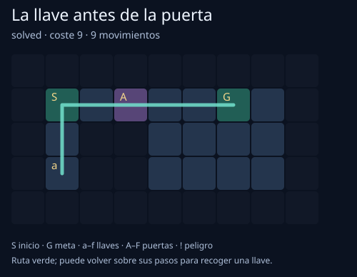

# Dungeon Planner Agent 🗝️

Un agente de planificación para mazmorras pequeñas: recoge llaves, atraviesa puertas y decide si merece la pena evitar un atajo peligroso. Devuelve una secuencia de movimientos reproducible y un mapa SVG de la ruta.

Creado el **24 de octubre de 2026**. **Python 3.10+, sin dependencias externas, APIs ni modelos descargados.**

## Ejecutar

```bash
git clone https://github.com/alvaroalcalaa/dungeon-planner-agent.git
cd dungeon-planner-agent
python planner.py --json plan.json --svg route.svg
python -m unittest -v
```

Abre `route.svg` en un navegador. El mapa predeterminado necesita recoger la llave antes de pasar la puerta: la solución cuesta **9**, con 9 movimientos. En algunos equipos usa `python3`.



La línea puede pasar dos veces por la misma casilla: el inventario cambia después de recoger una llave. El JSON muestra el orden exacto de movimientos, coordenadas y recogidas.

## Un agente que sopesa el coste

```bash
python planner.py maps/hazards.json --hazard-cost 5 --svg safe-route.svg
python planner.py maps/hazards.json --hazard-cost 1 --svg shortcut.svg
```

| Coste de entrar en peligro | Decisión | Coste total |
|---|---|---:|
| 5 | Rodea las casillas peligrosas, 7 movimientos | 7 |
| 1 | Toma el atajo, 5 movimientos | 5 |

El coste es una unidad de diseño que eliges tú, no una estimación de daño o probabilidad.

## Crear un mapa

Un archivo JSON con `name` y `grid`:

```json
{
  "name": "Mi mazmorra",
  "grid": [
    "########",
    "#SaA..G#",
    "########"
  ]
}
```

| Símbolo | Regla |
|---|---|
| `S` | Inicio, exactamente uno |
| `G` | Meta, exactamente una |
| `#` | Muro |
| `.` | Suelo |
| `a`–`f` | Llave reutilizable, recogida automáticamente |
| `A`–`F` | Puerta; necesita la llave de la misma letra |
| `!` | Casilla peligrosa, coste configurable |

Movimiento ortogonal sin diagonales. Entrar en una casilla cuesta 1 salvo el peligro. Las llaves no se consumen, y recoger una no añade coste extra. Puede haber varias copias de una llave. Las puertas sin llave disponible pueden dejar la meta inaccesible.

Los mapas deben ser rectangulares, con máximo 100 × 100 casillas y un archivo de hasta 1 MiB. Las coordenadas son `[x, y]`, empezando en cero en la esquina superior izquierda.

## Cómo planifica

Usa **A\*** con estado `(x, y, inventario)`. La heurística es la distancia Manhattan hasta la meta, ignorando muros y puertas. Como cada paso cuesta al menos 1, no sobrestima el coste restante.

El inventario permite diferenciar «estoy en esta casilla sin llave» de «he vuelto a la misma casilla con la llave». Con un estado que solo guardase la posición, este problema se resolvería mal.

En un mapa estático con estas reglas y presupuesto suficiente, encuentra una ruta de coste mínimo. Cuando hay empates usa un orden determinista; no garantiza un estilo de ruta particular.

## Presupuesto y salidas

```bash
python planner.py --max-states 1
python planner.py maps/unreachable.json
```

| Código CLI | Estado |
|---|---|
| 0 | `solved`: hay plan |
| 1 | `unreachable`: se agotó la búsqueda sin llegar |
| 2 | Mapa, parámetros o salida inválidos |
| 3 | `budget_exceeded`: se alcanzó el límite de estados examinados |

El límite máximo es 200 000 estados examinados. Llegar al presupuesto **no demuestra** que el mapa sea imposible. El informe contiene `expanded`, `cost`, `path`, `actions` y `keys`. Las salidas pueden escribirse con `--json` y `--svg`; sus carpetas deben existir. No pueden sobrescribir el mapa de entrada.

## Pruebas y límites

Las pruebas comprueban costes conocidos, recolección de varias llaves, vuelta sobre casillas visitadas, reproducción legal del plan, preferencia de rutas según peligro, metas inaccesibles, presupuesto, mapas inválidos y exportación real del CLI.

Es IA clásica de búsqueda y planificación: **no usa un LLM ni aprende de partidas**. El agente conoce todo el mapa; no hay niebla de guerra, enemigos móviles, azar, salud, llaves consumibles ni ejecución en un motor real. A\* almacena estados en memoria y puede crecer rápido con seis llaves. El límite cuenta estados extraídos de la cola, no un límite estricto de RAM.

Los mapas son ejemplos originales ficticios. Puedes usar esta base para prototipar comportamiento de NPCs o comprobar que un nivel con llaves tiene solución antes de llevarlo a un motor.
